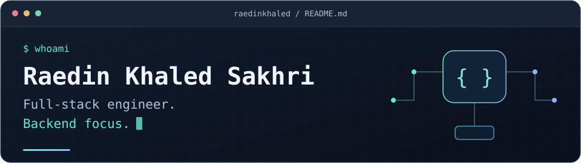

# Hi, I'm Raedin

I'm a **full-stack engineer with a backend focus**. My experience spans backend development, web migrations, Flutter, and academic machine learning.

I've worked on software projects alongside building a retail business. I'm now looking to contribute within a development team and deepen my engineering skills.

[LinkedIn](https://www.linkedin.com/in/raedin-khaled-sakhri-167850232/) · [Research models](https://huggingface.co/raedinkhaled) · [Email: raedinkhaled@outlook.com](mailto:raedinkhaled@outlook.com)

## Selected work

### GME | Vehicle service platform

Worked on a Spring Boot backend and a migration from an existing Django system. Implemented WebSocket dispatch and Redis-backed OTP data/caching, and worked on the Angular Signals admin dashboard.

*Past development project. My involvement ended in August 2026; code remains private.*

### Casbah Connect | Authentication and framework migration

Migrated Clerk authentication to NextAuth, added server-derived identity and ownership checks, and upgraded the Next.js, React, and TypeScript stack.

*Personal, course-based Q&A project. My contribution is the migration and hardening work.*

[Explore the repository](https://github.com/raedinkhaled/casbahconnect-next) · [Try the live demo](https://casbah-connect.vercel.app/)

### Cardiac MRI classification | M.Sc. research, 2022

Co-authored research on transformer models for heart-disease prediction, graded **18/20**. Fine-tuned ViT and Swin models with Hugging Face Transformers and PyTorch, built models from scratch with Keras/TensorFlow, and applied Grad-CAM to the CNN and from-scratch ViT.

*Academic research.* [Explore the model cards](https://huggingface.co/raedinkhaled)

## Technologies

| Focus | Languages and tools |
| :--- | :--- |
| Backend | Java, Spring Boot, REST APIs, SQL |
| Web | TypeScript, Angular, React, Next.js, MongoDB |
| Mobile | Flutter, Dart |
| Development tools | Git, Linux, Docker |

## A little more about me

- **Education:** M.Sc. in Data Engineering and Web Technologies and B.Sc. in Computer Science, Ferhat Abbas University.
- **Ongoing study:** M.Sc. in Artificial Intelligence at Johannes Kepler University Linz, part-time through distance learning and compatible with full-time employment.
- **Languages:** English and French at a professional level; native Bosnian and Arabic.

Open to **software engineering opportunities**, particularly backend work. [Let's connect on LinkedIn](https://www.linkedin.com/in/raedin-khaled-sakhri-167850232/).
